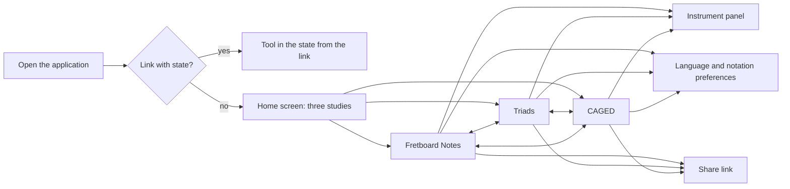
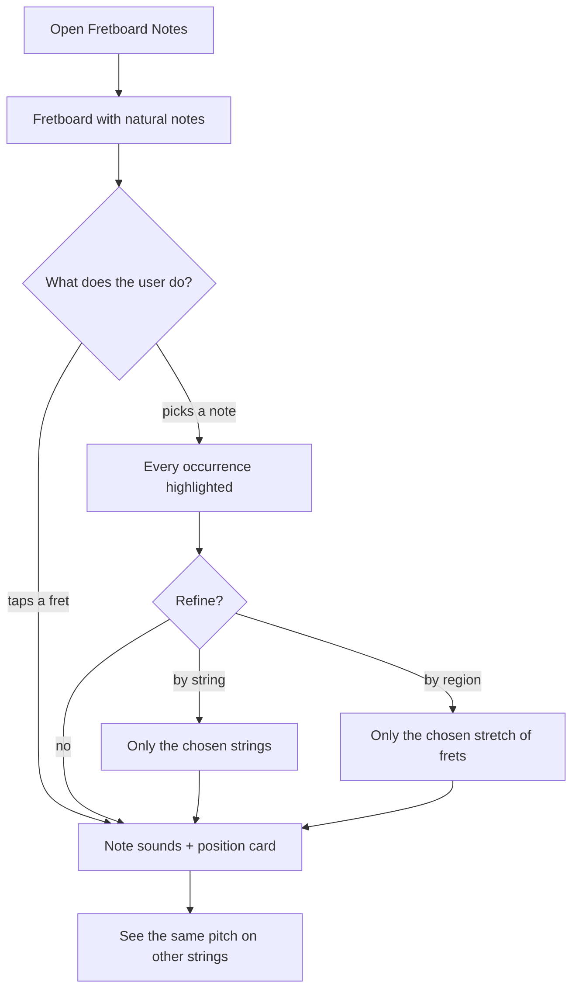
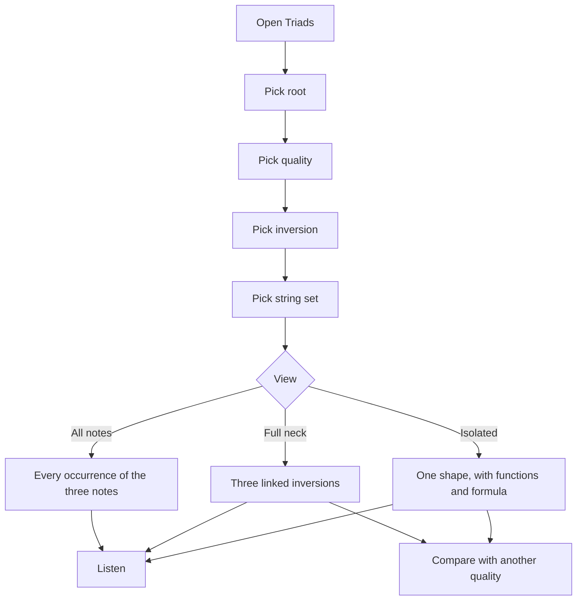
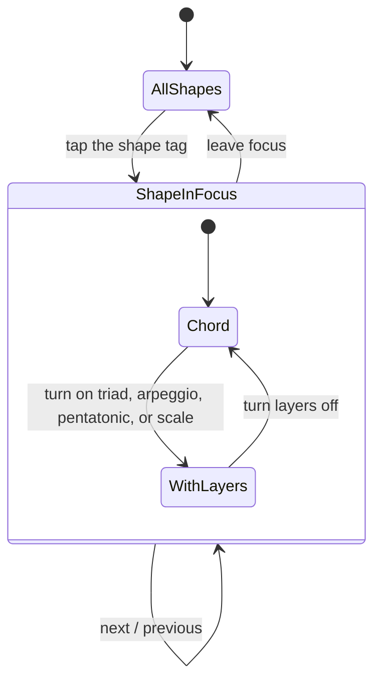
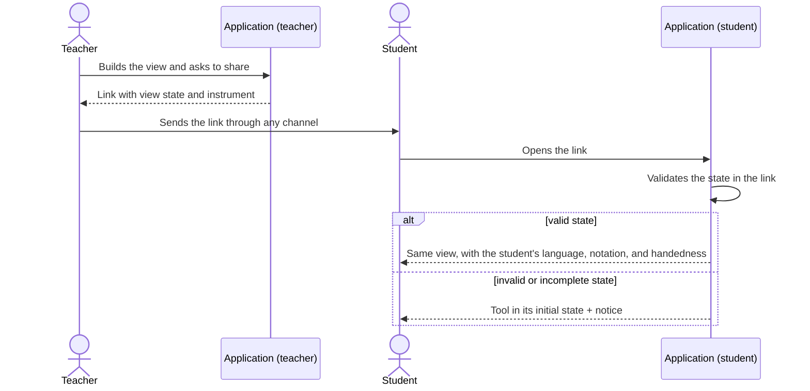

# 02 — User journeys

Each journey describes an end-to-end flow, with decision points and alternate paths. The requirements cited are in `03-functional-requirements.md`.

## Overall navigation map

Switching between tools preserves the musical context whenever it makes sense (FR-1.6): the note selected in Notes becomes the root in Triads; the root and quality in Triads become the key in CAGED.

---

## UJ-1 — First visit and choice of study

**Persona:** all. **Job:** J-14.

1. The user opens the application address, without a state link.
2. The system detects the device language and shows the home screen in that language if it is one of the three supported; otherwise in English (FR-8.2).
3. The home screen shows three cards — **Fretboard Notes**, **Triads**, **CAGED** — each with a title, one sentence stating the question the tool answers, and a thumbnail of the fretboard in that mode (FR-1.2).
4. Below the cards, one line summarizes the instrument in use ("6 strings · standard tuning · right-handed") with a shortcut to change it (FR-1.3).
5. The user taps a card.
6. The system opens the tool in its initial state (FR-4.1, FR-5.1, FR-6.1).

**Alternate paths**

- **3a. The user adjusts the instrument before choosing.** The user opens the instrument panel (UJ-5), confirms, and returns to the home screen; the thumbnails reflect the new configuration.
- **3b. The user changes the language.** The language selector is visible on the home screen; the change is immediate (FR-8.3).
- **Return visit.** On later visits, the home screen marks the card of the last tool used with "Continue" (FR-1.4). Nothing else about the study is remembered.

---

## UJ-2 — Locate a note on the fretboard

**Persona:** Lia (P-1). **Jobs:** J-1, J-2, J-3.

1. Lia opens **Fretboard Notes**. The fretboard appears with the natural notes labeled and the altered notes hidden (FR-4.1).
2. In the note selector, she taps **G**.
3. The system highlights every fret where G appears, on every string, and dims the rest (FR-4.3). Each occurrence shows its octave through a distinct highlight tone and a discreet number (FR-4.6).
4. Lia taps one of the occurrences. The system plays the note at the real pitch of that fret (FR-7.1) and shows a card with: note name, string, fret, and the other frets where the **same pitch** repeats (FR-4.7).
5. She turns on the **String 4** filter. The system keeps G highlighted and dims the other strings (FR-4.4).
6. She clears the selection. The fretboard returns to the state of step 1.

**Alternate paths**

- **2a. Altered note.** Lia picks the key between F and G. The selector shows both spellings (F♯ / G♭); the label on the fretboard follows the current accidental preference (FR-8.6).
- **2b. More than one note.** Lia selects C, E, and G. The system highlights all three, each with its label (FR-4.3). A "view as triad" shortcut appears when the selected notes form one of the four supported triads (FR-4.10).
- **1a. Hidden mode.** Lia turns the labels off. The frets are empty and the name appears only when she taps a fret (FR-4.8). This mode supports informal self-testing, without assessment.
- **5a. Region.** Instead of a string, Lia restricts the view to frets 5–9. The system dims the rest and, on a small screen, centers the region (FR-4.5).

---

## UJ-3 — Explore a triad and its inversions

**Persona:** Caio (P-2). **Jobs:** J-4, J-5, J-6.

1. Caio opens **Triads**. The initial state is C major, root position, string set 3-2-1, **Isolated** view (FR-5.1).
2. He picks the root **A**. The system recalculates and shows A–C♯–E on set 3-2-1, each note marked with its function: root, third, fifth (FR-5.2, FR-3.8).
3. A composition panel shows the triad formula: the three notes, the intervals from the root, and the distance between neighboring notes (major third + minor third) (FR-5.7).
4. He taps **Listen**. The system plays the triad arpeggiated and then as a block (FR-7.3).
5. He changes the inversion to **1st**. The shape changes; the panel states that the lowest note is now the third (FR-5.4).
6. He changes the set to **4-3-2**. The system shows the same inversion on the new set (FR-5.5).
7. He switches to the **Full neck** view. The system shows, on the chosen set, the three inversions linked along the neck, each one labeled (FR-5.9).
8. He turns on **Compare** and picks **minor**. The system overlays A minor on A major: the common notes stay, and the third appears in two positions with a one-fret arrow showing the movement (FR-5.11).
9. He taps **Listen to comparison**. The system plays the major triad and then the minor (FR-7.4).

Steps B to E have no mandatory order; each control acts independently.

**Alternate paths**

- **2a. Enharmonic spelling.** Caio picks the root between G and A. The system offers G♯ and A♭; for a major triad, the default is A♭ (fewer accidentals). He can switch (FR-5.3).
- **5a. Augmented triad.** The composition panel states that the three inversions have the same shape and that any of the three notes can be the root (FR-5.12).
- **6a. Wide-stretch shape.** In an alternate tuning, the calculated shape spans more than five frets. The system shows it anyway, with the "wide stretch" mark (FR-5.14).
- **6b. Shape beyond the fretboard.** The requested shape only exists above the configured fret count. The system shows the lowest available occurrence and, if none fits, the corresponding empty state (EC-5.2).
- **7a. "All notes" view.** The system shows every occurrence of the three notes across the neck, with their functions, without outlining shapes (FR-5.10).

---

## UJ-4 — Travel the neck with CAGED

**Persona:** Bruna (P-3). **Jobs:** J-7, J-8, J-9.

1. Bruna opens **CAGED**. The initial state is C major, the five shapes visible along the neck, **Chord** layer (FR-6.1).
2. Each shape occupies its region, identified by a tag ("C shape", "A shape"…) above the fretboard. The roots carry the root marker (FR-6.3).
3. She picks the key of **G**. The five regions move; the order of the shapes along the neck stays C → A → G → E → D, starting with the one that fits closest to the nut (FR-6.4).
4. She taps the **E shape** tag. The system puts the shape in focus: the others dim and, on a small screen, the fretboard centers the region (FR-6.5).
5. She turns on the **Arpeggio** layer. The system adds the triad notes that lie in the region and do not belong to the chord shape (FR-6.8).
6. She turns on the **Pentatonic** layer and then **Scale**. The notes appear with lighter marking than the chord notes, so the chord stays readable underneath (FR-6.9, FR-6.10).
7. She taps **Next shape**. The focus moves to the D shape; during the transition, the notes shared by the two shapes stay emphasized (FR-6.6, FR-6.7).
8. She turns on **Show connections**. With every shape visible, the system emphasizes the notes that belong to two neighboring shapes (FR-6.7).
9. She switches to **minor**. The system shows the five minor shapes of G, in the same order (FR-6.2).

**Alternate paths**

- **1a. Seven strings.** With the 7-string instrument, the chord shapes stay on the six higher strings; the arpeggio, pentatonic, and scale layers extend to the seventh string (FR-6.13).
- **1b. Left-handed.** The fretboard appears mirrored; tags and shape order follow the mirroring (FR-2.6).
- **1c. Non-compatible tuning.** With an open or custom tuning that does not preserve the standard intervals, the tool states that CAGED depends on the standard relationship between the strings and offers two ways out: view CAGED in standard tuning without changing the preference, or go to Triads (FR-6.14).
- **5a. Triad layer.** The system highlights, inside the shape in focus, the close-position triads on three adjacent strings; a shortcut leads to the same triad in the Triads tool (FR-6.11).
- **6a. Labels.** She switches the labels between note name, interval, and scale degree (FR-3.7).

---

## UJ-5 — Configure the instrument

**Persona:** Caio (P-2), Bruna (P-3). **Jobs:** J-10, J-13.

1. The user opens the instrument panel from any screen (FR-2.1).
2. The panel shows: string count (6 or 7), tuning, fret count, handedness (right or left), and string orientation (FR-2.2).
3. He picks **Drop D** from the list of preset tunings. The panel shows the note of each string and a preview of the fretboard (FR-2.4).
4. He confirms. The system applies the configuration to every tool, recalculates the current view, and stores the preference on the device (FR-2.9, FR-9.1).
5. The open tool now shows a discreet badge with the tuning in use whenever it differs from standard (FR-2.10).

**Alternate paths**

- **3a. Custom tuning.** He picks "Custom" and adjusts each string by semitone, within the allowed limits (FR-2.5). Each adjustment can be heard.
- **3b. Switch to 7 strings.** The tuning list now shows the 7-string presets; the previous 6-string tuning is kept on the six higher strings (FR-2.3).
- **4a. Current state incompatible.** If the current view no longer exists in the new configuration (for example, a string set that included the seventh string), the system adjusts to the nearest equivalent and states the adjustment (EC-2.3).
- **Restore.** A command restores the default instrument: 6 strings, standard tuning, 22 frets, right-handed (FR-2.11).

---

## UJ-6 — Adjust language and notation

**Persona:** Lia (P-1), Marcos (P-4). **Job:** J-15.

1. The user opens the language and notation preferences (FR-8.1).
2. The user picks the interface language: English, Portuguese, or Spanish.
3. The user picks the note-name notation: **letters** (C D E F G A B) or **solfège** (Do Re Mi Fa Sol La Si).
4. The user picks the accidental preference for the notes tool: sharps, flats, or both.
5. Every screen updates immediately, without reloading and without losing the tool state (FR-8.3, FR-8.5).
6. The system stores the choices on the device (FR-9.1).

**Alternate path**

- **3a. Quick toggle.** The notation can also be switched from a control in the tool bar, without opening the panel (FR-8.5).

---

## UJ-7 — Hear what is on screen

**Persona:** all. **Job:** J-11.

1. The user taps a fretboard position or a **Listen** command.
2. If it is the first sound of the session, the system enables audio on that gesture (FR-7.7).
3. The system plays the sound and lights up the corresponding positions in sync (FR-7.6).
4. The user adjusts the volume or mutes through the sound control in the tool bar (FR-7.8).

**Alternate paths**

- **2a. Audio unavailable.** The device does not allow playback. The system shows a single discreet notice and keeps working in silence (EC-7.1).
- **1a. Device in silent mode.** The system cannot work around it; the help text of the sound control mentions this cause (EC-7.2).
- **3a. New sound during playback.** The sound in progress stops and the new one starts (FR-7.9).

---

## UJ-8 — Share a view

**Persona:** Marcos (P-4). **Job:** J-12.

1. In class, Marcos builds the view he wants to show: CAGED, A minor, E shape in focus, Chord and Pentatonic layers.
2. He taps **Share** (FR-10.1).
3. The system generates a link that describes the tool, the view state, and the instrument, and copies it or hands it to the device's sharing mechanism (FR-10.2).
4. The student opens the link on a phone.
5. The system opens the tool directly in the described state, in the **student's** language, notation, and handedness (FR-10.4).
6. If the instrument in the link differs from the student's preferred instrument, the system shows the view with the instrument from the link and a notice: "This view uses [tuning from the link]", with the actions **Use mine** and **Adopt this one** (FR-10.5).

**Alternate paths**

- **5a. Invalid link.** Missing or out-of-range parameters are replaced with defaults; if the tool is not recognized, the home screen opens with a notice (EC-10.1).
- **3a. Copy unavailable.** If the device does not allow automatic copying, the system shows the link in a selectable field (EC-10.3).
