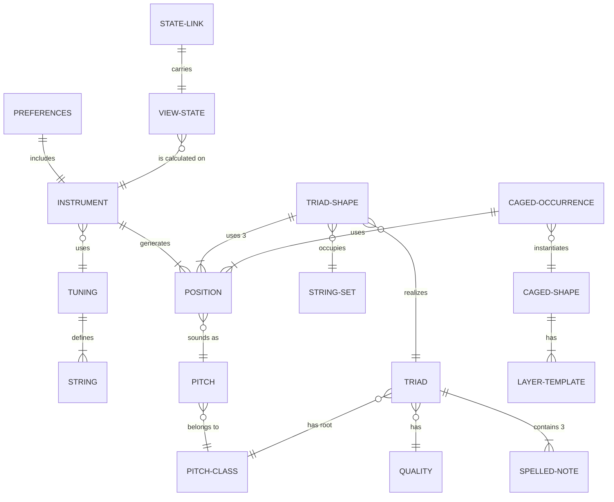

# 04 — Data model

A **logical** model. Types are descriptive ("identifier", "enumerated value", "integer", "text"); no storage form is prescribed.

The application holds no user data on a server. The entities fall into three groups:

| Group | Nature | Where it lives |
|---|---|---|
| Musical domain | Concepts and values **calculated** from rules | In memory, derived on demand |
| Catalogs | Fixed reference data, delivered with the application | Part of the application content |
| State and preferences | What the user chose | In memory (session state), on the device (preferences), or in the link (shared state) |

---

## Musical domain

### DM-1 — Pitch class

One of the twelve notes of the chromatic scale, without an octave.

| Attribute | Type | Note |
|---|---|---|
| chromatic index | integer from 0 to 11 | 0 = C |
| is natural | boolean | True for the seven notes without an accidental |

### DM-2 — Spelled note

A pitch class with a specific spelling. C♯ and D♭ are two spelled notes of the same class.

| Attribute | Type | Note |
|---|---|---|
| letter | enumerated value | One of the seven letters (C D E F G A B) |
| accidental | enumerated value | Double flat, flat, natural, sharp, double sharp |
| pitch class | reference to DM-1 | Derived from letter + accidental |

The displayed name (letter or solfège) is a presentation of the spelled note, resolved by language and notation (DM-16).

### DM-3 — Pitch

A note in a specific octave: what actually sounds.

| Attribute | Type | Note |
|---|---|---|
| semitone number | integer | Distance in semitones from a fixed reference pitch |
| pitch class | reference to DM-1 | Derived |
| octave | integer | Derived; convention in TM-1 |

### DM-4 — Tuning

| Attribute | Type | Note |
|---|---|---|
| identifier | identifier | AF-1 to AF-11, AF-21 to AF-23, or "custom" |
| name | translatable text key | Absent in custom tunings |
| string count | 6 or 7 | |
| open-string pitches | ordered list of pitches (DM-3) | From the lowest string to the highest |
| CAGED compatibility class | enumerated value | Compatible, compatible with an altered string, non-compatible (FR-2.12). Derived |

### DM-5 — Instrument

The configuration of the instrument in use.

| Attribute | Type | Note |
|---|---|---|
| string count | 6 or 7 | |
| tuning | reference to DM-4 | |
| fret count | integer from 12 to 24 | |
| handedness | right or left | Affects presentation only |
| string orientation | highest on top or lowest on top | Affects presentation only |

### DM-6 — Position

A point on the fretboard.

| Attribute | Type | Note |
|---|---|---|
| string | integer from 1 to 7 | 1 = highest |
| fret | integer from 0 to the fret count | 0 = open string |
| pitch | reference to DM-3 | Derived: open-string pitch + fret |

Handedness and orientation do not change the position; they change only where it is drawn.

### DM-7 — Triad quality

A catalog of four values.

| Attribute | Type |
|---|---|
| identifier | major, minor, diminished, augmented |
| third interval | 3 or 4 semitones |
| fifth interval | 6, 7, or 8 semitones |
| is symmetric | boolean (true only for augmented) |

### DM-8 — Triad

| Attribute | Type | Note |
|---|---|---|
| root | spelled note (DM-2) | |
| quality | reference to DM-7 | |
| third | spelled note | Derived (TM-4) |
| fifth | spelled note | Derived (TM-4) |

### DM-9 — String set

Three adjacent strings. Identified by the lowest string. There are four on 6 strings and five on 7 strings.

### DM-10 — Triad shape

A realization of a triad on the fretboard. Always calculated (TM-5).

| Attribute | Type | Note |
|---|---|---|
| triad | reference to DM-8 | |
| inversion | root position, 1st, 2nd | |
| string set | reference to DM-9 | |
| positions | three positions (DM-6), one per string | |
| function of each position | root, third, or fifth | |
| span | integer | Distance in frets between the lowest and the highest fretted fret |
| wide stretch | boolean | True when the span is 5 frets or more |
| octave index | integer | 0 for the lowest occurrence on the fretboard |

### DM-11 — CAGED shape

A catalog of ten values: five major shapes and five minor shapes.

| Attribute | Type | Note |
|---|---|---|
| identifier | C, A, G, E, D + quality | |
| strings with a root | list of strings | TM-6.1, TM-7.1 |
| layer templates | one per layer (DM-12) | |
| next and previous shape | references to DM-11 | Cyclic order C → A → G → E → D |
| notes shared with the next shape | list | TM-6.3 |

### DM-12 — Layer template

For each CAGED shape and each layer (chord, arpeggio, pentatonic, scale), the list of **relative** positions — string and fret offset from the reference fret of the shape — with the degree of each note. Defined for standard tuning; the reference values are in TM-6 and TM-7.

### DM-13 — CAGED shape occurrence

A CAGED shape applied to a key, in a region of the fretboard. Always calculated.

| Attribute | Type |
|---|---|
| shape | reference to DM-11 |
| key | spelled note |
| start fret and end fret of the region | integers |
| positions per layer | lists of positions (DM-6) with degree |
| fits on the fretboard | boolean |

---

## State and preferences

### DM-14 — Preferences

Stored on the device (FR-9.1). A single instance per device and browser.

| Attribute | Type |
|---|---|
| format version | integer |
| instrument | DM-5 |
| language | English, Portuguese, Spanish |
| notation | letters or solfège |
| accidental preference | sharps, flats, both |
| theme | light, dark, device |
| sound muted | boolean |
| volume | number from 0 to 1 |
| tempo | slow, medium, fast |
| last tool | notes, triads, CAGED, or none |
| label type per tool | one value per tool |
| notices already shown | list of notice identifiers (for example, the explanation in FR-8.9) |

Lifecycle: created with the defaults on the first visit; updated on every change; erased by FR-9.4 or by the browser's data clearing.

### DM-15 — View state

The musical state of a tool. It lives in memory during the session and can be carried by a link.

| Tool | Attributes |
|---|---|
| Notes | selected notes; active strings; region (start and end fret); background set (naturals, all, none); hidden mode; position in focus; label type |
| Triads | root (spelled note); quality; inversion; string set; view (isolated, full neck, all notes); octave index; comparison quality (optional); label type |
| CAGED | key (spelled note); quality (major, minor); shape in focus (optional) and its occurrence; layers on; connections on; string set of the Triad layer; temporary tuning (FR-6.14); label type |

Lifecycle: created in the initial state when the tool opens; changed by the controls; discarded at the end of the session (FR-9.2).

### DM-16 — Text catalog

For each language, the interface texts, the note names in each notation, the tuning names, the musical terms, and the screen-reader descriptions. Reference data, delivered with the application.

### DM-17 — State link

A transportable representation of a view state (FR-10.3).

| Attribute | Type |
|---|---|
| format version | integer |
| tool | notes, triads, CAGED |
| view state | DM-15 |
| instrument | string count, tuning, fret count |

It contains no handedness, orientation, language, notation, theme, sound, or any identifier of a person or device.

### DM-18 — Usage event (conditional)

Exists only if anonymous measurement is adopted (INT-2, open question Q-1).

| Attribute | Type |
|---|---|
| event type | enumerated value (tool opened, first fretboard interaction, sound played, link shared, link opened, instrument changed) |
| tool | enumerated value |
| device class | phone, tablet, desktop |
| language | enumerated value |
| instrument characteristics | string count, preset tuning identifier or "custom", handedness |

It contains no identifier of a person, a device, or a persistent session, and no content of custom tunings.
