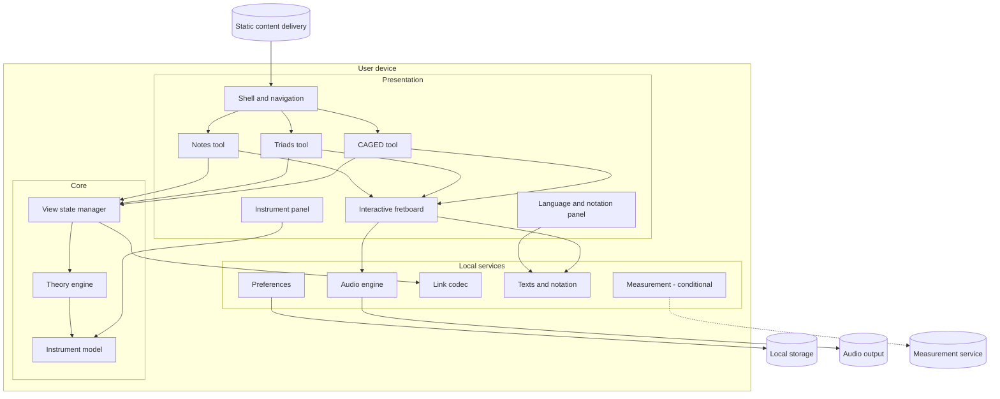
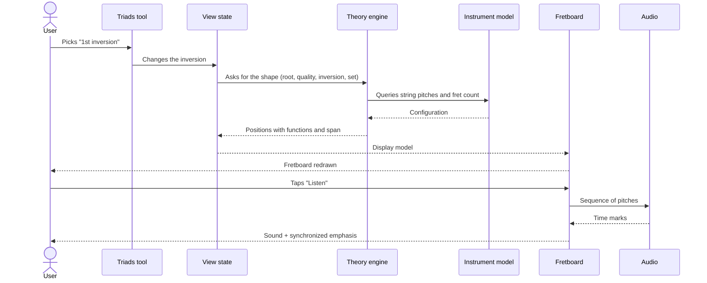

# 07 — Architecture overview

A view of components and responsibilities, without technology choices. The central structural decision: **all logic runs on the user's device**. The only role of a server is to deliver static content.

## 1. Overview

## 2. Components

### ARCH-1 — Shell and navigation

- Presents the home screen, the navigation between tools, and the "About" page.
- Interprets the address at opening: no state → home screen; with state → hands it to the link codec (ARCH-10).
- Applies theme and language.
- Requirements: area 1.

### ARCH-2 — Theory engine

- A set of pure rules, stateless and unaware of the screen: equal inputs always produce the same result.
- Responsibilities: note and pitch arithmetic; triad spelling; triad-shape calculation for any tuning; occurrences of the CAGED shapes and their layers; tuning compatibility classification; triad detection from three notes.
- It does not know language, notation, handedness, or orientation.
- It is the component verified by NFR-9.2 and NFR-9.3.
- Requirements: TM-1 to TM-8; FR-5.2 to FR-5.6, FR-5.14, FR-6.2 to FR-6.16, FR-4.10.

### ARCH-3 — Instrument model

- Holds the instrument configuration (DM-5) and the tuning catalog (DM-4).
- Provides the theory engine with the pitch of each open string and the limits of the fretboard.
- Notifies the other components when the configuration changes.
- Requirements: area 2.

### ARCH-4 — View state manager

- Holds the state of each tool (DM-15) during the session.
- Converts the state into a **display model**: the list of positions to draw, each with function, emphasis level, label, and grouping (shape, tag, comparison arrow).
- Carries context over between tools (FR-1.6).
- It is the extension point foreseen in NFR-10.3: a future lesson layer drives the tools through it.

### ARCH-5 — Interactive fretboard

- Draws the display model it receives: strings, frets, inlays, markers, labels, tags, arrows, minimap.
- Applies handedness and orientation at drawing time — it is the only component that knows them.
- Handles touch, pointer, keyboard, scrolling, and fit to screen.
- Returns events to the tools in musical terms ("position string 3, fret 5 activated"), never in screen coordinates.
- Generates the equivalent text description (FR-3.18).
- Contains no musical rule.
- Requirements: area 3.

### ARCH-6 — Tools (Notes, Triads, CAGED)

- Each tool gathers its controls, its side panel (position card, composition panel, layer selector), and one instance of the fretboard.
- Translates user actions into state changes (ARCH-4).
- Does not calculate theory and does not draw the fretboard.
- Requirements: areas 4, 5, and 6.

### ARCH-7 — Audio engine

- Receives requests in musical terms: one pitch, a set of simultaneous pitches, or a sequence with a tempo.
- Produces the sound and emits the time marks used for synchronized emphasis (FR-7.6).
- Manages enabling by gesture, volume, mute, and interruption.
- Requirements: area 7.

### ARCH-8 — Preferences

- Reads, validates, migrates, and writes the preferences (DM-14) in local storage.
- Provides defaults when there is no data or when storage is unavailable.
- Requirements: area 9.

### ARCH-9 — Texts and notation

- Resolves every displayed text according to the language.
- Converts spelled notes (DM-2) into displayed names according to the notation and the accidental preference.
- Provides the full readings for assistive technologies (NFR-3.9).
- Requirements: area 8, NFR-4.

### ARCH-10 — Link codec

- Converts view state + instrument into a link and back (DM-17).
- Validates every received value and applies defaults to the invalid ones (EC-10.1, NFR-6.2).
- Keeps the browser address in sync with the state (FR-10.6).
- Requirements: area 10.

### ARCH-11 — Measurement (conditional)

- Emits anonymous events (DM-18) asynchronously and tolerates failure.
- Exists only if Q-1 is decided in favor.

## 3. Communication patterns

| Interaction | Pattern |
|---|---|
| Controls → state → fretboard | One-way, synchronous flow: the action changes the state; the state generates the display model; the fretboard redraws |
| Instrument, language, notation → every screen | Change notification: interested components react and recalculate |
| Fretboard → audio | Asynchronous request; audio returns time marks for the emphasis |
| Application → local storage | Single read at opening; write on every preference change, without blocking the interface |
| Application → measurement | Asynchronous, batched sending, without delivery guarantee |
| Browser → content delivery | Request and response, at opening only |

## 4. Flow of a typical interaction

## 5. Structural decisions and rationale

| Decision | Rationale |
|---|---|
| Everything calculated on the device | There is no user data; removes network latency (NFR-1.3) and per-user cost (NFR-7.2) |
| Shapes calculated, not hand-drawn | The only way to support variable tunings, 7 strings, and fret counts (C-6) |
| Handedness and orientation only at drawing time | The theory engine and the link stay independent of how each person sees the fretboard (FR-10.4) |
| A single fretboard component | Identical behavior in the three tools; one place for accessibility and touch |
| Fretboard events in musical terms | The tools do not depend on screen geometry |
| View state separate from the tools | Enables the state link, context carry-over, and a future lesson layer |
