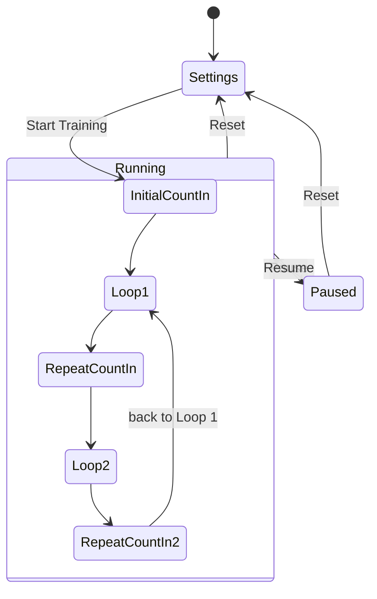

# Metronome Trainer Specification

Oct 29, 2026 · @Rodrigo Zampieri Castilho

## Overview

This spec describes a web-based practice metronome with three modes (Metronome, Speed Training, Ratios Training), a count-in system, a visual beat indicator and a practice timer, replicating the tool shown in [NathanGuitar's speed-building video](https://www.youtube.com/watch?v=Jp-xitAS1kQ) (sections 4:18 and 7:18). The app is a private community tool, not a public product, so everything here comes from on-screen observation.

**Observed vs inferred.** Only the Ratios Training tab is used on camera. Its settings panel, running display, count-in and loop behaviour are documented from the video. The Metronome and Speed Training tabs appear as tab labels only; their behaviour is specified below as sensible defaults and marked *inferred*.

**Scope.** In scope: the metronome panel (all three modes) and the practice timer. Out of scope: the surrounding lesson content ("Areas of focus" tags, lesson pager 2/5, Mirror camera button), accounts, syncing and lesson authoring.

**Platform.** Browser app (desktop and mobile), dark theme, audio via Web Audio API.

## Shared metronome engine

All three modes run on one engine: a lookahead scheduler on the Web Audio API clock that emits clicks and drives the beat indicator. Settings below are shared unless a mode overrides them.

| Parameter | Observed value | Range / default | Control |
| --- | --- | --- | --- |
| BPM | 85 | 30–300, default 85, step 1 | Slider + −/+ buttons + numeric readout |
| # of Beats (beats per loop) | 4 (2 also seen) | 1–16, default 4 | Slider + −/+ buttons |
| Count In | On | On/Off, default On | Toggle switch |
| Initial Count In | 4 | 0–8 clicks, default 4 | Slider + −/+ (shown only when Count In is On) |
| Repeat Count In | 2 | 0–8 clicks, default 2 | Slider + −/+ (shown only when Count In is On) |

**Audio.** Two click sounds: an accented click on beat 1 and a normal click on other beats; subdivision clicks (Ratios mode) use a third, softer sound. Clicks are scheduled ahead (≈100 ms lookahead, 25 ms scheduler tick) so timing is drift-free regardless of UI frame rate. Clicks continue when the browser tab is in the background.

**Visual beat indicator.** A row of dots, one per beat in the current loop (2 dots when # of Beats = 2, 4 when it is 4). The current beat's dot is lit orange, beats already played stay dimmed orange, upcoming beats are grey. During count-in only a single dot is shown and it pulses on each click.

**Status line.** Above the dots, the running display shows the current position in small caps, e.g. `BEAT 2/4 · SUB 3` or `COUNT IN 1/2`, with the BPM in large orange digits on the right.

## Mode 1 — Metronome *(inferred)*

A plain click at a fixed BPM, with the shared controls (BPM, # of Beats, Count In) and no training logic.

- Beat 1 of each loop is accented; the beat indicator cycles through the dots.
- Count In applies: Initial Count In clicks before the first loop; Repeat Count In is not used (there is no loop change to count into).
- Optional, nice to have: tap tempo (tap the BPM readout 4+ times to set BPM) and a subdivision selector (quarter, 8ths, triplets, 16ths) that adds softer clicks between beats.

## Mode 2 — Speed Training *(inferred)*

The metronome climbs from a start BPM to a target BPM in fixed steps, giving the player a set number of loops at each tempo — the classic speed-building trainer.

| Setting | Default | Notes |
| --- | --- | --- |
| Start BPM | current BPM | Slider + −/+ |
| Target BPM | Start + 40 | Must be ≥ Start BPM |
| Increment | 5 BPM | 1–20 |
| Loops per step | 4 | Number of full # of Beats loops played at each tempo before stepping up |
| Count In | shared | Initial Count In before the first step; Repeat Count In before each tempo change |

- The running display shows `STEP 3/9 · LOOP 2/4` and the current BPM; the BPM readout updates at each step.
- When Target BPM is reached the trainer either stops or holds at target (setting, default: hold).
- Pause/Resume and Reset behave as in the shared run states below.

## Mode 3 — Ratios Training *(observed)*

The metronome alternates between two subdivision patterns at a constant BPM, so the player practises switching ratios (e.g. 8th-note triplets ↔ sextuplets) without the tempo moving. This is the mode used throughout the video.

**Settings panel** (shown before Start):

| Row | Control | Observed | Behaviour |
| --- | --- | --- | --- |
| BPM | slider, −/+, readout | 85 | Shared BPM |
| # of Beats | slider, −/+, readout | 4 | Beats per loop; the beat indicator shows this many dots |
| Count In | toggle | On | Shows/hides the two rows below |
| Initial Count In | slider, −/+, readout | 4 | Clicks before Loop 1 starts |
| Repeat Count In | slider, −/+, readout | 2 | Clicks inserted every time the pattern switches between Loop 1 and Loop 2 |
| Subdivision ratio | section toggle | On | When Off, only Loop 1 plays (no alternation) |
| Loop 1 | dropdown | 8th Triplets | Subdivision for the first loop |
| Loop 2 | dropdown | Sextuplets | Subdivision for the second loop |
| Start Training | orange full-width button | — | Enters the running display |

**Subdivision options** (same list for both dropdowns): Quarter notes (1), 8th notes (2), 8th Triplets (3), 16th notes (4), Quintuplets (5), Sextuplets (6), Septuplets (7), 32nd notes (8). The number is clicks per beat.

**Sequence** with the observed settings (85 BPM, 4 beats, count-in 4/2):

1. Initial Count In: 4 accented clicks at 85 BPM. Display `COUNT IN 1/4` … `4/4`, single pulsing dot.
2. Loop 1: 4 beats of 8th triplets — accented click on each beat plus 2 soft subdivision clicks. Display `BEAT n/4 · SUB 3`.
3. Repeat Count In: 2 clicks. Display `COUNT IN 1/2`, `2/2`.
4. Loop 2: 4 beats of sextuplets — accented click on each beat plus 5 soft clicks. Display `BEAT n/4 · SUB 6`.
5. Repeat Count In again, then back to Loop 1. Repeat until paused or reset.

The `SUB` value in the status line is the clicks-per-beat of the loop currently playing. With # of Beats = 2 the display reads `BEAT 2/2 · SUB 3` and two dots are shown, matching the first footage in the video.

## Run states and controls

The panel has two views: the settings view (idle) and the running view. Start Training swaps one for the other; Reset swaps back.

Start Training enters the initial count-in, then Loop 1 and Loop 2 alternate with a repeat count-in between every switch; Pause and Resume hold the position, Reset returns to settings.

| Control | Where | Behaviour |
| --- | --- | --- |
| Start Training | Settings view, orange full-width button | Validates settings, enters running view, begins Initial Count In |
| Pause | Running view, grey full-width button with pause icon | Stops audio immediately; display freezes on the current beat; button becomes Resume |
| Resume | Same button, orange with play icon | Continues from the frozen beat (no new count-in) |
| Reset | Small red square button with ↺ icon, right of Pause/Resume | Stops audio, returns to the settings view with the same settings |
| Mode tabs | Metronome / Speed Training / Ratios Training | Switching tabs while running stops playback and shows that mode's settings view |

- Settings edited in the settings view persist across Reset, tab switches and page reloads (local storage).
- Keyboard: Space toggles Start/Pause/Resume; Esc resets.
- The status line and dots update on every click so the player can read the position without looking at the BPM readout.

## Practice timer *(observed)*

A countdown timer sits above the metronome panel so the player can time-box each exercise; in the video it is set to 2 minutes and never started.

- Header: stopwatch icon + "Timer".
- Preset pills: `1m 2m 3m 4m 5m 6m 7m 8m 9m 10m`; the selected pill is outlined green. Tapping a preset sets the countdown and stops any running timer.
- Readout: large seven-segment style digits `02:00`, counting down in seconds.
- Round play button on the right starts the countdown; it becomes a pause button while running. A tap on the selected preset again resets to the full duration.
- At zero the readout flashes and a short chime plays; the metronome keeps running (timer and metronome are independent).
- Timer state is independent of mode tabs and survives Reset of the metronome.

## UI layout and visual design

Single column, dark theme, card-based; the metronome card is roughly 440 px wide on desktop and full-width on mobile.

**Metronome card, top to bottom**

1. Tab bar with three equal tabs: `♩ Metronome`, `⚡ Speed Training`, `+ Ratios Training`. Active tab has orange text and a 2 px orange underline; inactive tabs are muted grey.
2. Settings view: label on the left (fixed \~110 px column), slider in the middle, then `−` `value` `+` on the right in a pill. Toggles are iOS-style switches, orange when on.
3. Section header `SUBDIVISION RATIO` in small caps with a green on/off switch on the right; Loop 1 / Loop 2 rows use full-width dark dropdowns with a chevron.
4. Primary button: full-width, orange (#F59E0B-ish), rounded 10 px, dark text, play icon + label.
5. Running view replaces rows 2–4 with the status box (thin orange border, dark fill): status line top-left, BPM top-right (large orange digits, small `BPM` unit), dot row centred below.
6. Below it: Pause/Resume full-width button and the small red Reset square (red border, red ↻ icon) side by side.

**Colour tokens**

| Token | Use | Approx. value |
| --- | --- | --- |
| bg-page | page background | #0E1116 |
| bg-card | cards, status box | #151A21 |
| bg-control | sliders track, dropdowns, pills | #1C222B |
| accent-orange | active tab, sliders, primary button, BPM digits, lit dots | #F59E0B |
| accent-green | timer selection, toggles, section markers | #2ECC8A |
| danger-red | Reset button | #E5484D |
| text-primary / text-muted | labels / secondary text | #F3F4F6 / #8B93A1 |

**Responsive.** Sliders shrink first; the −/+ pill keeps a minimum 96 px. On phones the tab labels drop their icons.

## Non-functional requirements and acceptance criteria

Timing accuracy is the product: a click that drifts or stutters makes every mode useless.

**Non-functional**

- Click jitter ≤ 2 ms and no cumulative drift over 10 minutes at any BPM (measured against the AudioContext clock).
- Audio starts within 50 ms of tapping Start; the first click is never cut off (resume a suspended AudioContext on the first user gesture, iOS included).
- Works offline after first load (PWA); no account required.
- Settings persist per mode in local storage.
- Accessible: all controls keyboard-operable, sliders expose value and range, dots have an `aria-live` text equivalent of the status line.

**Acceptance criteria**

- [ ] At 85 BPM with 4 beats, triplets ↔ sextuplets and count-in 4/2, the audible sequence is: 4 clicks, 4 beats × 3, 2 clicks, 4 beats × 6, 2 clicks, 4 beats × 3 … with no gap or overlap at the switches.
- [ ] The status line shows `COUNT IN n/4`, then `BEAT n/4 · SUB 3`, `COUNT IN n/2`, `BEAT n/4 · SUB 6`, in step with the audio.
- [ ] Changing # of Beats to 2 shows 2 dots and `BEAT n/2`.
- [ ] Count In Off removes the two count-in rows and plays no count-in clicks.
- [ ] Subdivision ratio Off plays Loop 1 only, with no repeat count-in.
- [ ] Pause freezes the dot and status line; Resume continues from that beat without a count-in; Reset returns to the settings view.
- [ ] Speed Training climbs from Start to Target BPM by the Increment after each N loops and shows the step counter.
- [ ] Timer presets 1–10 min count down in seconds and chime at zero while the metronome keeps running.
- [ ] Clicks continue when the tab is hidden and when the phone screen locks (as far as the platform allows).

## Open questions (not visible in the video)

- [ ] Metronome tab: is it a plain click, or does it also have subdivisions and tap tempo?
- [ ] Speed Training tab: step size, loops per step and whether it stops or holds at target BPM.
- [ ] Full list of subdivision options in the Loop 1 / Loop 2 dropdowns (only 8th Triplets and Sextuplets are seen).
- [ ] Do beat 1 and subdivision clicks use different sounds, and can the user choose sounds or volume?
- [ ] Does the timer auto-start the metronome, or stop it at zero?
- [ ] Upper and lower BPM limits of the slider.

**Sources**

- [NathanGuitar — The Boring But 100% Guaranteed Way To Build Insane Speed](https://www.youtube.com/watch?v=Jp-xitAS1kQ), frames at 4:18–5:00 and 7:18–7:40.
